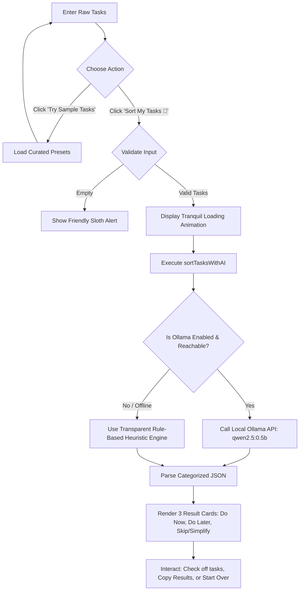

# 🦥 LazyList AI

<div align="center">

```
   (\_/)
  ( •_•)   "Do less. Stress less."
  / >🦥
```

### **Your tasks. Less stress.**
*A tranquil, lightweight task organizer built for the **Slow and Steady** hackathon.*

[](https://slow-and-steady-phi.vercel.app/)
[](#-tech-stack)
[-8E9C90?style=for-the-badge)](#-zero-dependency-architecture)
[-3F704D?style=for-the-badge)](#-optional-open-weight-ai-with-ollama)
[](#-license)

<br/>

> 🌐 **Live Web App:** **[https://slow-and-steady-phi.vercel.app](https://slow-and-steady-phi.vercel.app/)**  
> *No installation or configuration needed — test it live right now!*

<br/>

[](https://vercel.com/new/clone?repository-url=https%3A%2F%2Fgithub.com%2FMdFaisalDevops%2Fslow-and-steady)

</div>

---

## 📖 Table of Contents

- [🌿 Overview & Philosophy](#-overview--philosophy)
- [✨ Key Features](#-key-features)
- [⚡ Quick Start (No Setup Required)](#-quick-start-no-setup-required)
- [🦥 How It Works](#-how-it-works)
- [🤖 Optional Open-Weight AI with Ollama (`qwen2.5:0.5b`)](#-optional-open-weight-ai-with-ollama-qwen2505b)
- [🎨 Design System & Aesthetics](#-design-system--aesthetics)
- [🛠️ Tech Stack & Architecture](#️-tech-stack--architecture)
- [📋 Hackathon Requirements Verification](#-hackathon-requirements-verification)
- [📄 License & Credits](#-license--credits)

---

## 🌿 Overview & Philosophy

Modern productivity tools are often loud, complex, and anxiety-inducing. Users dump 40 tasks into a backlog, feel paralyzed by the sheer volume, and fall into perfectionist burnout.

**LazyList AI** is the antidote. Built around the spirit of the **Slow and Steady** hackathon:
- **Ruthless Trimming:** Not every task deserves your energy today.
- **Calm Prioritization:** Instead of 10 complex priority levels, tasks are sorted into exactly three intuitive buckets.
- **Anti-Perfectionism:** Identifies overcomplicated rabbit holes and gives you permission to drop or simplify them.
- **Privacy & Lightweight:** Zero telemetry, zero cloud tracking, zero paid APIs, and zero build steps.

> *“Less busywork. More breathing room.”*

---

## ✨ Key Features

- **Single-File Architecture:** The entire application lives in a self-contained [`index.html`](file:///c:/Users/mdfai/Downloads/Slow%20and%20Steady%20webapp/index.html).
- **Tranquil Visual Design:** Soothing cream canvas (`#FAF7F2`), gentle forest and sage green accents (`#3F704D`), rounded cards, and smooth micro-animations.
- **✨ Try Sample Tasks:** One-click pre-populated task batches (work, student life, weekend chores) so you can test instantly.
- **Live Task Counter:** Dynamically updates task counts as you type.
- **Friendly Validation:** Gentle, humorous validation alerts if you attempt to sort an empty list (*"Take it easy! Please enter at least one task before sorting. 🦥"*).
- **Soothing Loading State:** An animated swaying sloth with a gentle breathing ring creates a moment of calm during sorting.
- **Three Clear Result Cards:**
  1. ⚡ **Do Now:** High-impact, time-sensitive priorities to knock out first with calm focus.
  2. 🌿 **Do Later:** Meaningful tasks that can comfortably wait for tomorrow or next week.
  3. 🦥 **Skip or Simplify:** Overcomplicated rabbit holes, perfectionism, or busywork to drop or delegate.
- **Interactive Checklists:** Click any task to toggle a smooth strikethrough completion state.
- **📋 Copy Results:** Formats your sorted results into a clean markdown summary and copies it directly to your clipboard with a confirmation toast.
- **🔄 Start Over:** Seamlessly resets the view to start fresh.
- **Dual Sorting Engine:**
  - **Demo Mode (Default):** Transparent, deterministic rule-based keyword heuristic sorting that works out of the box with zero dependencies.
  - **Ollama AI Mode (Optional):** Integration with the open-weight **`qwen2.5:0.5b`** model running locally on your machine.

---

## ⚡ Quick Start

You do **not** need to install Node.js, Python, npm, or any external package to run LazyList AI.

### Option 1: Live Web App (Instant — No Installation)
Visit the live deployed app directly in your browser:  
👉 **[https://slow-and-steady-phi.vercel.app](https://slow-and-steady-phi.vercel.app/)**

### Option 2: Direct Local File
Double-click [index.html](file:///c:/Users/mdfai/Downloads/Slow%20and%20Steady%20webapp/index.html) or open it directly in any browser:
```text
file:///c:/Users/mdfai/Downloads/Slow%20and%20Steady%20webapp/index.html
```

### Option 3: Local Web Server
If you prefer running via a local HTTP server:

**Using Python:**
```powershell
python -m http.server 3000 --bind 127.0.0.1
```
Then visit: **[http://localhost:3000](http://localhost:3000)**

**Using Node.js:**
```powershell
npx serve .
```

---

## 🦥 How It Works



### The Three Buckets Explained

| Bucket | Focus | Examples |
| :--- | :--- | :--- |
| **⚡ Do Now** | Immediate deadlines, critical fixes, high-impact items. | *"Pay electricity bill today"*, *"Fix checkout bug for customer"*, *"Submit tax receipts"* |
| **🌿 Do Later** | Thoughtful, long-term planning, items with flexible timing. | *"Schedule dentist checkup"*, *"Plan roadmap for Q3"*, *"Draft blog post outline"* |
| **🦥 Skip or Simplify** | Overambitious goals, busywork, perfectionism, fluff. | *"Overhaul entire life routine by 6am"*, *"Color-code bookshelf by emotional resonance"*, *"Read 14 quantum papers"* |

---

## 🤖 Optional: Open-Weight AI with Ollama (`qwen2.5:0.5b`)

LazyList AI includes a cleanly isolated JavaScript function:
```javascript
async function sortTasksWithAI(tasks)
```
This function is decoupled from the UI and can query a local open-weight model via Ollama's free REST API.

### Why `qwen2.5:0.5b`?
- **Ultra-Lightweight:** Only ~398 MB in size.
- **Fast Execution:** Generates responses in under 500ms on CPU.
- **Private & Free:** Runs 100% locally on your machine with zero cloud API keys and zero cost.

### Setup Steps

1. **Install Ollama:**  
   Download from [ollama.com](https://ollama.com).

2. **Download the Model:**  
   Run this once in your terminal:
   ```bash
   ollama run qwen2.5:0.5b
   ```

3. **Start Ollama with Allowed Origins (CORS):**  
   Because web browsers restrict cross-origin requests from web pages, launch Ollama with CORS enabled:

   - **Windows (PowerShell):**
     ```powershell
     $env:OLLAMA_ORIGINS="*"
     ollama serve
     ```
   - **Windows (Command Prompt):**
     ```cmd
     set OLLAMA_ORIGINS=*
     ollama serve
     ```
   - **macOS / Linux:**
     ```bash
     OLLAMA_ORIGINS="*" ollama serve
     ```

4. **Activate in LazyList AI:**  
   - In the header of the app, click **“⚙️ Optional Local Ollama (qwen2.5:0.5b)”**.
   - Click **“Test Connection”** to verify `http://localhost:11434`.
   - Click **“Use Ollama”**.
   - If Ollama is ever closed or unreachable, LazyList AI automatically falls back to **Demo Mode — Rule-based sorting** without interrupting your workflow.

---

## 🎨 Design System & Aesthetics

| Token | Hex Value | Purpose |
| :--- | :--- | :--- |
| `--bg-cream` | `#FAF7F2` | Soothing background canvas |
| `--bg-surface` | `#FFFFFF` | Clean card background |
| `--bg-subtle` | `#F3ECE1` | Badge and pill container background |
| `--green-primary` | `#3F704D` | Primary action button and key accents |
| `--green-hover` | `#325B3E` | Hover state for primary buttons |
| `--green-light` | `#EBF3ED` | Brand pill and badge fill |
| `--green-border` | `#C2DEC9` | Soft subtle border color |
| `--do-now-bg` | `#FCF5EB` | Warm amber tint for urgent tasks |
| `--do-later-bg` | `#EEF5F1` | Soft sage tint for deferred tasks |
| `--skip-bg` | `#F5F3F8` | Lavender pebble tint for simplified tasks |

- **Typography:** Modern clean sans-serif using Google Fonts *Plus Jakarta Sans* (`wght@400;500;600;700;800`) with system UI fallbacks.
- **Responsiveness:** Fluid grid that gracefully transitions from 3 columns on desktop to 1 column on mobile devices.

---

## 🛠️ Tech Stack & Architecture

- **Markup:** Semantic HTML5 (`<header>`, `<main>`, `<article>`, `<section>`, `<footer>`, `<dialog>`-free accessible accordion).
- **Styles:** Pure Vanilla CSS embedded in `<style>` tags with CSS Custom Properties.
- **Scripts:** Vanilla ECMAScript (ES2020+) embedded in `<script>` tags.
- **Zero Third-Party Build Tools:** No Webpack, Vite, Tailwind, Babel, or React.
- **Memory Footprint:** Under 5 MB RAM in modern browsers.

---

## 📋 Hackathon Requirements Verification

| Requirement | Implementation Detail | Status |
| :--- | :--- | :---: |
| App Name & Tagline | **LazyList AI** with *“Do less. Stress less. 🦥”* | ✅ Passed |
| Vanilla Tech Stack | Pure HTML, CSS, and Vanilla JS inside single `index.html` | ✅ Passed |
| Design Aesthetics | Cream background, soft green accents, sloth emoji, rounded cards | ✅ Passed |
| Heading | *“Your tasks. Less stress.”* | ✅ Passed |
| Input Text Area | Multiline task entry, 1 task per line, live counter | ✅ Passed |
| Sample Tasks Button | *“✨ Try Sample Tasks”* with multi-preset cycling | ✅ Passed |
| Sort Tasks Button | *“Sort My Tasks 🦥”* | ✅ Passed |
| Three Result Cards | *Do Now*, *Do Later*, and *Skip or Simplify* | ✅ Passed |
| Export & Reset | *“📋 Copy Results”* (with clipboard toast) & *“🔄 Start Over”* | ✅ Passed |
| Empty Validation | Friendly, gentle alert banner with shake animation | ✅ Passed |
| Loading Indicator | Animated swaying sloth with circular breathing ring | ✅ Passed |
| Footer | *“Less busywork. More breathing room.”* | ✅ Passed |
| Separated AI Function | Independent `sortTasksWithAI(tasks)` implementation | ✅ Passed |
| Transparent Fallback | Clearly labeled *“Demo Mode — Rule-based sorting”* | ✅ Passed |
| Open-Weight Model | Local Ollama integration targeting `qwen2.5:0.5b` | ✅ Passed |
| Verification & Testing | Browser automated testing of all buttons & states | ✅ Passed |

---

## 📄 License & Credits

- **License:** MIT License. Feel free to use, modify, and build upon this project.
- **Event:** Crafted for the **Slow and Steady** Hackathon.
- **Author:** Built with ☕ & 🦥 for a calmer, less stressful digital world.
